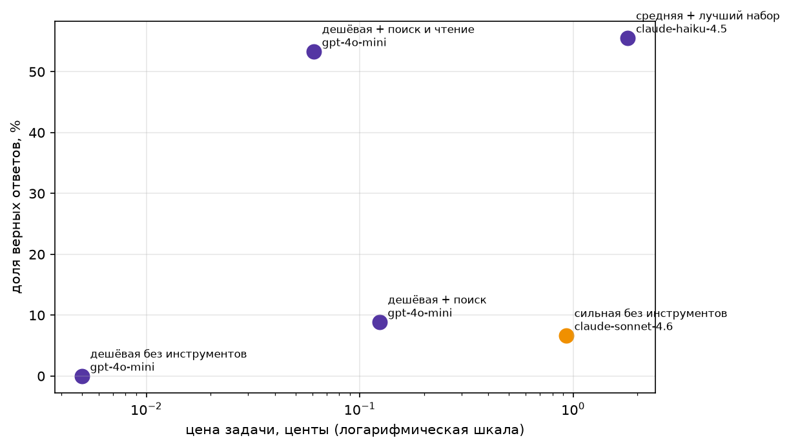

# Домашнее задание 1 — свежие вопросы и агент

## Тема набора
Наука и технологии 2026 года. Факты взяты из обзорных страниц английской Википедии:
- 2026 in science
- 2026 in spaceflight
- 2026 in technology and computing
- 2026 in climate change
- 2026 in paleontology
- 2026 in archaeology
- 2026 in biology

## Как собирался датасет
С помощью уже готового скрипта `fetch_fresh.py` скачивались полные тексты вики страниц, брались на факты с датой (январь–октябрь 2026), дешёвая модель (`gpt-4o-mini`) генерировала из каждого факта вопрос
с коротким ответом, затем сильная модель (`claude-sonnet-4.6`) отвечала без инструментов.
Оставлялись только те вопросы, где сильная модель ошиблась. Итоговый набор — 45 вопросов в `data/fresh.jsonl`.

## Проверка свежести
```
$ python check_fresh.py data/fresh.jsonl
записей: 45, проблем: 0

$ python check_fresh.py data/fresh.jsonl --sonnet
Sonnet без инструментов: 0 из 45 верно, 0%.
```

## Итоговая таблица замера

| config | model | n | accuracy | cost_per_task | cost_per_correct | avg_steps | avg_seconds |
|---|---|---|---|---|---|---|---|
| дешёвая без инструментов | gpt-4o-mini | 45 | 0.00% | 0.05 ¢ | ∞ | 1.00 | 4.2 |
| дешёвая + поиск | gpt-4o-mini | 45 | 8.89% | 0.12 ¢ | 1.39 ¢ | 8.07 | 35.4 |
| дешёвая + поиск и чтение | gpt-4o-mini | 45 | 53.33% | 0.06 ¢ | 0.11 ¢ | 4.53 | 18.6 |
| сильная без инструментов | claude-sonnet-4.6 | 45 | 6.67% | 0.93 ¢ | 13.93 ¢ | 1.00 | 10.6 |
| средняя + лучший набор | claude-haiku-4.5 | 45 | 55.56% | 1.81 ¢ | 3.25 ¢ | 5.38 | 23.2 |



## Вывод

Тезис курса подтвердился.

Лучший агент — дешёвая модель (`gpt-4o-mini`) с инструментами `web_search` и `page_find` —
даёт 53% верных ответов при цене 0.06 ¢ за задачу. Sonnet 4.6 без инструментов показывает
всего 7% верных и стоит 0.93 ¢ за задачу, примерно в 15 раз дороже
и в 8 раз менее точен. Разница ещё сильнее заметна по цене верного ответа: 0.11 ¢ у агента против
13.93 ¢ у Sonnet без инструментов примерно в 126 раз дешевле правильный ответ.

Почему так: Sonnet обучен до 2026 года и не знает событий этого года, а обзорные страницы
Википедии («2026 in science», «2026 in climate change») содержат десятки конкретных фактов
с датами, которые лежат в теле статьи, а не в введении. Инструмент `page_find`, читающий
полный текст обзорных страниц по ключевым словам, — главный источник качества: добавление
его к базовому `web_search` поднимает точность с 9% до 53%.

Что не подтвердилось: средняя модель `claude-haiku-4.5` с теми же инструментами даёт
чуть лучшую точность (56% против 53%), но примерно в 30 раз дороже за задачу.

## Два разобранных провала

**Провал 1 — поиск не нашёл нужную обзорную страницу**

Трейс: traces/дешёвая + поиск и чтение/gpt-4o-mini/fresh-2.json

Вопрос про страну с наибольшей устойчивостью по обзору от 23 августа 2026 (эталон Australia, факт лежит в 2026 in science). Агент семь раз вызвал web_search с вариациями запроса и каждый раз получал нерелевантное: «2026 Iran war fuel crisis», «International Energy Agency», «Cyber Security and Resilience Bill». Обзорная страница 2026 in science в выдаче не появилась ни разу, и агент так и не перешёл к page_find, хотя системный промпт это предписывал. На мягком завершении ответил FINAL: <информация недоступна>.

Сломалось: поиск не нашёл — индекс Википедии не ранжирует обзорную страницу по слову «resilience» выше статей про топливный кризис и кибербезопасность.


**Провал 2 — ответ верный, но не прошёл проверку**

Трейс: traces/дешёвая + поиск и чтение/gpt-4o-mini/fresh-17.json

Вопрос про дату закрытия Ubisoft Halifax (эталон January 8 из 2026 in technology and computing). Агент отработал по стратегии образцово: web_search вернул other articles: 2026 in video games, 2026 in Canada, агент вызвал page_find на трёх страницах и на 2026 in Canada нашёл строку «January 7 – Ubisoft closes Ubisoft Halifax». Ответил FINAL: January 7, 2026. Проверка is_correct не прошла, потому что эталон January 8 не содержится в ответе January 7 — это реальное расхождение дат между двумя обзорными статьями Википедии об одном событии, а не ошибка агента.

Сломалось: ответ верный, но не прошёл проверку — is_correct требует дословного вхождения эталона, привязанного к одной конкретной странице.
